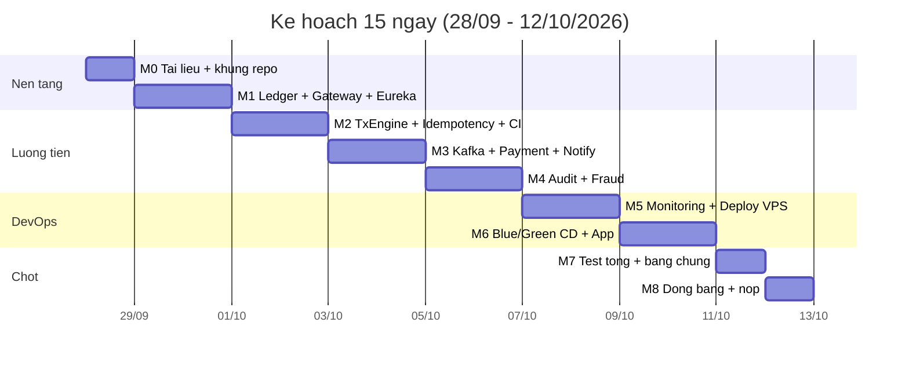

# 06 — MILESTONE & TIẾN ĐỘ (28/09 → 12/10/2026)

> **Bắt đầu:** Thứ Hai 28/09/2026 · **Hạn nộp:** trước 13/10/2026 → **phải xong toàn bộ trong ngày 12/10/2026**.
> **Tổng thời gian:** 15 ngày (2 tuần + 1 ngày đệm). **Thứ Bảy & Chủ Nhật vẫn phải làm** — lịch này không có chỗ cho nghỉ trọn cuối tuần.
> **Nguyên tắc:** mỗi ngày là 1 mốc có **Definition of Done (DoD)** kiểm chứng được. Không làm xong DoD thì **cắt scope**, không dồn sang ngày sau.

---

## 1. TỔNG QUAN MỐC LỚN

| Mốc | Ngày | Nội dung | Kết quả phải có |
|---|---|---|---|
| **M0** | 28/09 (T2) | Chốt tài liệu + dựng khung repo | Repo build được, hạ tầng nền chạy |
| **M1** | 29–30/09 | Discovery + Gateway + Ledger (kế toán kép) | Chuyển tiền qua gRPC, tổng sổ = 0 |
| **M2** | 01–02/10 | Transaction Engine + Idempotency + CI | 100 request trùng → trừ 1 lần; CI xanh/đỏ đúng |
| **M3** | 03–04/10 | Kafka + Notification + Payment webhook | **Luồng tiền chạy end-to-end ở local** |
| **M4** | 05–06/10 | Audit/đối chiếu + Fraud | Chuỗi hash hợp lệ, báo cáo đối chiếu, fraud chặn được |
| **M5** | 07–08/10 | Monitoring + Deploy VPS | Dashboard có data, alert Telegram, API chạy HTTPS trên VPS |
| **M6** | 09–10/10 | Blue/Green + CD + App React Native | Deploy 0 downtime, app gọi API thật |
| **M7** | 11/10 (CN) | Kiểm thử tổng + thu thập bằng chứng | Đủ bằng chứng cho **mọi tiêu chí chấm điểm** |
| **M8** | 12/10 (T2) | Đóng băng + viết báo cáo + nộp | **Nộp xong trước hạn** |

### Timeline

---

## 2. KẾ HOẠCH THEO NGÀY

### M0 — Thứ Hai 28/09: Tài liệu + khung repo
**Việc:**
- Chốt tài liệu `01` → `05` (đã xong).
- Tạo khung `backend/` Maven multi-module: parent POM + 9 module + Maven Wrapper.
- `.gitignore`, `.env.example`, chiến lược branch (`main` + `feature/*`).
- Dựng `infra/docker/docker-compose.yml` nền: Postgres, Redis, Kafka KRaft (+ init tạo 5 DB).
- Tạo 5 database: `tx_db`, `ledger_db`, `payment_db`, `notification_db`, `audit_db`.

**DoD:**
- [ ] `./mvnw clean verify` chạy xanh trên khung (chưa có logic).
- [ ] `docker compose up -d postgres redis kafka` → cả 3 healthy, `psql -l` thấy 5 DB.
- [ ] Push lên `main`, repo sạch (không commit `target/`, `.env`).

---

### M1 — Thứ Ba 29/09 → Thứ Tư 30/09: Discovery + Gateway + Ledger

**Ngày 2 (29/09) — Eureka + API Gateway:**
- `eureka-server`: `@EnableEurekaServer`, dashboard có basic auth.
- `api-gateway`: `spring-cloud-starter-gateway`, đăng ký Eureka, route `lb://`.
- Filter tuỳ biến `HmacAuthFilter`: verify `HMAC-SHA256` + `X-Timestamp` (±300s), từ chối `400 INVALID_SIGNATURE`.
- Rate limit Redis (`RequestRateLimiter`), CORS, `X-Request-Id`.

**DoD ngày 2:**
- [ ] Gateway gọi được `lb://eureka-server`; Eureka hiện đủ service đã đăng ký.
- [ ] Request không có `X-Signature` → `400 INVALID_SIGNATURE`.
- [ ] Request ký đúng → đi qua; rate limit trả `429`.

**Ngày 3 (30/09) — Account & Ledger (phần khó nhất):**
- `proto/ledger.proto` + build sinh stub (protobuf-maven-plugin).
- Entity `Account`, `LedgerEntry` (`@Immutable`), `AccountBalance`.
- gRPC: `PostTransfer`, `Deposit`, `GetBalance`, `GetStatement`.
- Seed 3 tài khoản hệ thống: `SYSTEM_MASTER`, `FEE_INCOME`, `SUSPENSE`.
- Khoá tài khoản `SELECT ... FOR UPDATE` theo **thứ tự `accountId` tăng dần**; isolation `REPEATABLE READ`.
- Ghi ≥2 dòng ledger, **tổng = 0**; cập nhật snapshot trong cùng transaction.

**DoD ngày 3:**
- [ ] Test: mọi giao dịch có `SUM(ledger_entries.amount) = 0` (JUnit).
- [ ] Test: snapshot == `SUM(entries)` sau giao dịch.
- [ ] Test: chuyển tiền A→B qua gRPC thành công, số dư đúng.
- [ ] Test: A→B và B→A đồng thời **không deadlock** (integration test).

---

### M2 — Thứ Năm 01/10 → Thứ Sáu 02/10: Transaction Engine + Idempotency + CI

**Ngày 4 (01/10):**
- Entity `Transaction` (state machine), `FraudAlert`, `OutboxEvent`.
- `IdempotencyService` (Redis, TTL 24h) + `Redisson` lock.
- gRPC client → ledger (deadline 3s, `resilience4j`).
- API `transfer` / `deposit` / `withdraw` + các API đọc.

**DoD ngày 4:**
- [ ] Idempotency: cùng key + cùng payload → trả kết quả cũ, `Idempotent-Replay: true`.
- [ ] Cùng key + payload khác → `409 IDEMPOTENCY_CONFLICT`.
- [ ] Ledger chết → `503 UPSTREAM_UNAVAILABLE` (circuit breaker mở), không trừ tiền.

**Ngày 5 (02/10) — CI:**
- `backend-ci.yml`: `mvn -B verify` + Testcontainers + jacoco + Trivy scan.
- Cache `~/.m2`, matrix không cần (1 JDK).
- Bật required status check + branch protection trên `main`.

**DoD ngày 5:**
- [ ] Pipeline xanh trên `main`.
- [ ] Cố tình làm fail 1 test → pipeline đỏ, chặn merge.
- [ ] Report coverage + kết quả scan là artifact của workflow.

---

### M3 — Thứ Bảy 03/10 → Chủ Nhật 04/10: Kafka + Notification + Payment

**Ngày 6 (03/10):**
- `OutboxPublisher` (scheduler đẩy `tx.completed` từ `outbox_events`).
- `notification-service`: consumer Kafka + email Thymeleaf + `notification_logs` + dead-letter.

**DoD ngày 6:**
- [ ] Chuyển tiền thành công → có `notification_logs` `status=SENT` (dùng MailHog/local SMTP).
- [ ] Kafka tắt → event vẫn nằm `outbox_events` `status=NEW`; Kafka bật lại → tự publish (không mất event).
- [ ] Consumer lỗi → retry rồi vào `dead_letter_events`.

**Ngày 7 (04/10):**
- `payment-gateway-service`: `PaymentIntent`, `WebhookLog`, tạo checkoutUrl/QR.
- `/webhooks/{provider}`: verify chữ ký đối tác + chống trùng (`UNIQUE(provider,event_id)` + Redis) → bắn `payment.succeeded`.
- `POST /internal/payments/{id}/simulate-callback` cho demo.
- tx-engine consumer `payment.succeeded` → cộng ví qua gRPC.

**DoD ngày 7 — MỐC LỚN:**
- [ ] **Nạp tiền end-to-end:** tạo intent → giả lập webhook → ví tăng đúng số tiền.
- [ ] Webhook gửi lại lần 2 → không cộng tiền lần 2 (`duplicate: true`).
- [ ] Webhook sai chữ ký → từ chối.

> **Hết ngày 7:** luồng tiền chạy end-to-end ở local. Đây là mốc quan trọng nhất — nếu trễ ở đây, **cắt mục 4 (Fraud nâng cao)** ngay.

---

### M4 — Thứ Hai 05/10 → Thứ Ba 06/10: Audit + Fraud

**Ngày 8 (05/10):**
- `audit-service`: `AuditLog` (chuỗi hash), `ReconciliationReport`.
- Job đối chiếu (Spring Batch, fallback `@Scheduled`) → `difference` phải = 0.
- Custom metric `ledger_imbalance_total`, `reconciliation_last_success_timestamp_seconds`.

**DoD ngày 8:**
- [ ] `GET /api/v1/audit/verify-chain` → `valid: true`.
- [ ] `POST /api/v1/reconciliation/run` → `status=BALANCED`, `difference=0`.
- [ ] Cố tình sửa 1 bản ghi audit → verify-chain phát hiện sai.
- [ ] Giả lập lệch sổ → metric tăng + log ERROR.

**Ngày 9 (06/10):**
- `FraudRuleEngine` trong tx-engine: VELOCITY, AMOUNT_LIMIT, NEW_DEVICE, GEO_ANOMALY → ALLOW/REVIEW/BLOCK.
- Ghi `fraud_alerts`, bắn `risk.alert`.

**DoD ngày 9:**
- [ ] 10 giao dịch trong 1 phút → alert VELOCITY, decision BLOCK → API trả `422 FRAUD_BLOCKED`.
- [ ] Giao dịch vượt hạn mức → bị chặn.

---

### M5 — Thứ Tư 07/10 → Thứ Năm 08/10: Monitoring + Deploy VPS

**Ngày 10 (07/10):**
- `infra/monitoring`: Prometheus scrape `/actuator/prometheus` (7 service) + node-exporter + cadvisor.
- Grafana dashboard: throughput, p95 latency, error rate, tài nguyên VPS, **số dư đối chiếu**.
- Alertmanager → Telegram: `ledger_imbalance`, error rate > 2%, service down, RAM/disk > 85%.
- Loki + Promtail gom log JSON, tra theo `requestId`/`traceId`.

**DoD ngày 10:**
- [ ] Grafana có dữ liệu thật của ít nhất 4 service.
- [ ] `docker stop transaction-engine` → Telegram nhận alert trong ≤ 2 phút.
- [ ] Tra 1 `requestId` ra được log xuyên 2 service trên Loki.

**Ngày 11 (08/10) — lên VPS:**
- VPS Ubuntu: tạo user, khoá SSH key (tắt password), UFW (chỉ 22/80/443), Docker + Compose.
- Nginx: TLS Certbot, HTTP/2, `conf.d/api.conf` + `grpc.conf` (`grpc_pass` → ledger:9090).
- `docker-compose.prod.yml` + `.env` trên VPS (không commit), giới hạn RAM từng container.

**DoD ngày 11:**
- [ ] `https://api.<domain>/actuator/health` trả `UP`.
- [ ] Gọi gRPC qua Nginx thành công (grpcurl).
- [ ] `docker stats` tổng RAM < 7GB.

---

### M6 — Thứ Sáu 09/10 → Thứ Bảy 10/10: CD Blue/Green + App

**Ngày 12 (09/10):**
- `backend-cd.yml`: build → Jib push GHCR → SSH deploy → smoke test → notify Telegram.
- `deploy.sh`: blue/green 2 slot, Nginx chuyển traffic sau health-check; `rollback.sh`.

**DoD ngày 12:**
- [ ] Push `main` → tự deploy lên VPS, không thao tác tay.
- [ ] Deploy khi đang bắn tải: **không request nào fail** (0 downtime).
- [ ] `rollback.sh` đưa về bản cũ trong 1 lệnh.

**Ngày 13 (10/10) — App React Native:**
- Khởi tạo Expo + TypeScript; màn login, số dư, chuyển tiền, lịch sử.
- `api/hmac.ts` ký HMAC-SHA256; gửi `X-Idempotency-Key`.

**DoD ngày 13:**
- [ ] App trên điện thoại/emulator đăng nhập được vào API thật trên VPS.
- [ ] Chuyển tiền từ app → số dư đổi, có thông báo.

---

### M7 — Chủ Nhật 11/10: Kiểm thử tổng + Bằng chứng

**Việc:**
- k6: 100 request trùng `X-Idempotency-Key` đồng thời → chỉ trừ 1 lần.
- k6: chuyển tiền A↔B đồng thời với tải lớn → không deadlock, không sai số dư.
- Fault injection: kill Kafka / Ledger / Redis giữa giao dịch → không lệch tiền.
- Chạy lại đối chiếu sau tất cả → `difference = 0`.
- Thu thập bằng chứng: ảnh dashboard, log, kết quả k6, alert Telegram, video demo ngắn.

**DoD:**
- [ ] Bảng bằng chứng (mục 4) **đủ 100%**, mỗi tiêu chí có file/ảnh/log kèm theo.
- [ ] Sau toàn bộ test phá hoại: `difference = 0`.

---

### M8 — Thứ Hai 12/10: Đóng băng + Nộp

**Việc:**
- **Freeze code** (không thêm feature sau thời điểm này).
- `README.md` hướng dẫn chạy + báo cáo đồ án + sơ đồ kiến trúc cuối.
- Video demo 5–10 phút theo kịch bản ở doc 04 mục 9.
- Backup `pg_dump` toàn bộ DB; tag release `v1.0.0`.

**DoD:**
- [ ] Nộp **xong trong ngày 12/10**.
- [ ] Tag `v1.0.0`, repo sạch, tài liệu `docs/01`→`08` đầy đủ.

---

## 3. DANH SÁCH CẮT KHI TRỄ (THEO THỨ TỰ)

Cắt từ trên xuống, **không bao giờ** cắt các mục ở bảng "KHÔNG CẮT".

1. OpenTelemetry tracing (Tuần 2 — điểm cộng).
2. Loki/Promtail → dùng `docker logs` + ảnh dashboard.
3. Fraud nâng cao (GEO_ANOMALY, NEW_DEVICE) → giữ VELOCITY + AMOUNT_LIMIT.
4. Spring Batch → `@Scheduled` + `JdbcTemplate`.
5. UI app đẹp → chỉ cần 4 màn hình thô.
6. Notification push → chỉ giữ email.

**KHÔNG CẮT:**
- ❌ Kế toán kép + ràng buộc tổng = 0
- ❌ Idempotency (Redis + UNIQUE key)
- ❌ Concurrency/lock ordering chống deadlock
- ❌ gRPC giữa Tx Engine ↔ Ledger
- ❌ HMAC verify ở Gateway
- ❌ CI + deploy thật trên VPS
- ❌ Monitoring/alert lệch sổ cái

---

## 4. BẰNG CHỨNG THEO TIÊU CHÍ CHẤM ĐIỂM

| Tiêu chí đề bài | Bằng chứng phải có | Xong ở |
|---|---|---|
| Toàn vẹn tài chính (kế toán kép) | Test `SUM = 0`; `GET /transactions/{id}/ledger-entries`; báo cáo `BALANCED` | M1, M4 |
| Idempotency & Concurrency | Kết quả k6 100 request → 1 lần trừ; test A↔B không deadlock | M2, M7 |
| Hiệu năng gRPC trên VPS | `grpcurl` chạy qua Nginx + log latency gRPC | M5 |
| Nạp tiền qua webhook | Video/log: webhook → ví tăng; webhook lặp không cộng 2 lần | M3 |
| Chuyển tiền 2 ví + sổ cái biến động | Video demo + ảnh ledger entries | M3 |
| Từ chối request thiếu HMAC / sai key | Log `400 INVALID_SIGNATURE`, `409 IDEMPOTENCY_CONFLICT` | M1, M2 |
| CI/CD nghiêm ngặt | Ảnh pipeline xanh/đỏ + deploy 0 downtime + rollback | M2, M6 |
| Monitoring & Alerting | Ảnh Grafana + tin nhắn Telegram cảnh báo lệch sổ | M5 |

---

## 5. RỦI RO & ĐỐI ỨNG

| Rủi ro | Xác suất | Đối ứng |
|---|---|---|
| Ledger/lock ordering ngốn thời gian (M1) | Cao | Làm sớm nhất (ngày 3); nếu trễ → giảm snapshot, chỉ giữ entry + khoá `FOR UPDATE` |
| Kafka ăn RAM trên VPS 8GB | Trung bình | Giới hạn `mem_limit`; bỏ Loki trước tiên |
| VPS/domain chưa sẵn sàng ngày 11/10 | Trung bình | Chuẩn bị VPS + domain từ M0, không để đến ngày deploy |
| Cổng thanh toán sandbox chưa có tài khoản | Trung bình | Dùng `simulate-callback` nội bộ để demo, không phụ thuộc đối tác |
| Debug CI tốn thời gian | Trung bình | Viết CI ngày 5 (sớm), không để cuối |
| 2 tuần quá chặt | **Cao** | Theo danh sách cắt ở mục 3; T7/CN vẫn làm |

---

## 6. NHẮC NHỞ CUỐI

- **Ngày 7 (04/10)** là mốc gãy: chưa có luồng tiền end-to-end thì phải cắt scope ngay, không dồn.
- **Ngày 12/10** là ngày nộp, không phải ngày code — mọi thứ phải xong từ **11/10**.
- Repo phải luôn ở trạng thái chạy được; không để `main` đỏ qua đêm.

**Tài liệu tiếp theo:** `07-cicd-deployment.md` → `08-monitoring.md`.
