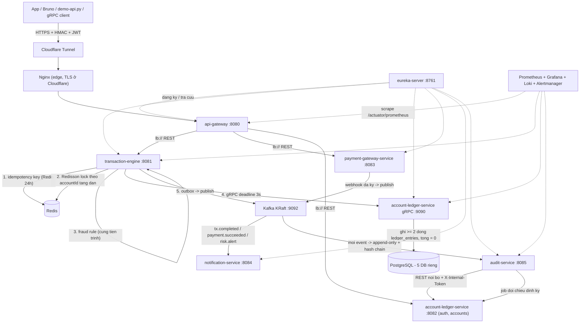

# 01 — TỔNG QUAN DỰ ÁN (toàn diện, đối chiếu thẳng với `README.MD`)

> File này là bản tổng quan **đầy đủ**: dự án là gì → 7 service → sơ đồ → luồng sự kiện → **đã làm được gì /
> chưa làm được gì theo từng mục của README** → hạ tầng vận hành thật → **10 câu hỏi hay bị hỏi nhất**.
>
> Phân biệt với các file khác trong thư mục: `00-tom-tat-du-an.md` là **phiếu 1 trang** (cheat sheet để dán
> vào agent), còn file này là bản đọc để nắm cả hệ thống. Chi tiết theo chủ đề: `02` kiến trúc · `03` 3 giai đoạn
> kỹ thuật · `04` deploy · `05` kịch bản bảo vệ.
>
> Môi trường thật đang chạy: VPS `160.187.228.112`, domain `https://www.fintech-wallet4105.bid`,
> repo trên VPS `/opt/fintech`, ảnh build từ GHCR, deploy blue/green.

---

## 1. DỰ ÁN LÀ GÌ (theo `README.MD` §1)

**FinTech Wallet & Payment Gateway** — hệ thống ví điện tử + cổng thanh toán nội bộ doanh nghiệp trên kiến trúc
**microservices**: quản lý tài khoản ví, **nạp / rút / chuyển tiền**, xử lý thanh toán, **đối soát tài chính tự động**,
**phát hiện giao dịch bất thường** và **ghi sổ kế toán kép**.

README §1 nêu 2 yêu cầu kiểu doanh nghiệp, và đây cũng là 2 bất biến của hệ thống:

1. **Zero Financial Error** — không được sai lệch tiền trong **mọi** trường hợp.
2. **Concurrency + Idempotency + nhất quán dữ liệu phân tán** — phải chống được giao dịch trùng lặp và chạy song song.

Bối cảnh chấm: đây là **đồ án DevOps**, nên phần container hoá / CI-CD / deploy / monitoring **có trọng số ngang
phần code**. Vì vậy tài liệu này ghi cả "đường tiền" lẫn "đường vận hành".

---

## 2. BẢY SERVICE ĐANG CHẠY

| # | Service | Port | Store | Vai trò (một câu) |
|---|---|---|---|---|
| 1 | `eureka-server` | 8761 | — | Service discovery (**thêm so với README**) |
| 2 | `api-gateway` | 8080 | Redis | Edge: verify **HMAC**, **JWT**, rate-limit, routing `lb://`, circuit breaker |
| 3 | `transaction-engine` | 8081 | `tx_db` + Redis | Nhận lệnh nạp/rút/chuyển; **idempotency**, **Redisson lock**, **fraud rule engine nhúng**, outbox |
| 4 | `account-ledger-service` | 8082 + gRPC **9090** | `ledger_db` | `users`/`accounts`/**`ledger_entries`** (kế toán kép) + cấp JWT + gRPC server |
| 5 | `payment-gateway-service` | 8083 | `payment_db` + Redis | Payment intent + **webhook đối tác** (verify chữ ký, chống trùng) |
| 6 | `notification-service` | 8084 | `notification_db` | Consumer Kafka → gửi email (Mailpit) + dead-letter |
| 7 | `audit-service` | 8085 | `audit_db` | **Audit log chuỗi hash** (bất biến) + **job đối chiếu** + metric cảnh báo lệch sổ |

**Module dùng chung (không phải service):** `common` (DTO, error model, HMAC util, Kafka topics) và
`proto` (`ledger.proto`, `common.proto` → sinh Java stub). Tổng **9 module Maven**, build bằng `./mvnw`.

**Bề mặt API:** **37 REST endpoint** (STT 1–37) + **8 RPC** của `ledger.v1.LedgerService`
(`PostTransfer`, `Deposit`, `Withdraw`, `GetBalance`, `GetStatement`, `GetAccountByNumber`,
`GetLedgerEntries`, `GetAccountsByOwner`).

---

## 3. SƠ ĐỒ TỔNG QUAN



**Giao tiếp — chọn cơ chế gì và vì sao:**

| Đường | Cơ chế | Vì sao |
|---|---|---|
| Client → Gateway | HTTPS + **HMAC-SHA256** + JWT | Chống sửa dữ liệu trên đường truyền (README §2.1 #1) |
| Gateway → service | REST qua **Eureka `lb://`** | Blue/green đổi port liên tục → không được hardcode `host:port` |
| TxEngine → Ledger (đường tiền) | **gRPC** + deadline **3s**, **không retry** | README §2.2; không retry để không thể trừ tiền 2 lần |
| TxEngine / Payment → Kafka | Event qua **Transactional Outbox** | Không publish trong transaction DB |
| Kafka → Notify / Audit | consumer **idempotent** | Redelivery là no-op |
| Audit → Ledger | REST nội bộ + `X-Internal-Token` | Không đọc chéo DB của service khác |

---

## 4. LUỒNG SỰ KIỆN CHÍNH (đầy đủ)

### 4.1. Luồng chuyển tiền (đồng bộ + bất đồng bộ)

```
App → Cloudflare → Nginx → api-gateway
     │  verify HMAC (X-Signature + X-Timestamp ±300s) → verify JWT → rate limit (20 req/s, burst 40)
     ▼
transaction-engine
     │ 1) X-Idempotency-Key: Redis SETNX (TTL 24h)  ── trùng + cùng payload → trả lại response cũ
     │                                              ── trùng + khác payload → 409 IDEMPOTENCY_CONFLICT
     │                                              ── đang chạy           → 409 DUPLICATE_REQUEST
     │ 2) Redisson lock theo từng accountId, THỨ TỰ TĂNG DẦN (chống deadlock)
     │ 3) fraud rule engine: VELOCITY / AMOUNT_LIMIT → ALLOW | REVIEW | BLOCK (422 FRAUD_BLOCKED)
     │ 4) gRPC PostTransfer (deadline 3s) ─────────────────────────────────────► account-ledger-service
     │      ledger: khoá 2 account FOR UPDATE theo thứ tự tăng dần → ghi 2 dòng
     │              Nguồn −amount | Đích +amount → cập nhật snapshot cùng transaction
     │ 5) transaction → SUCCESS, ghi outbox_events (cùng transaction DB)
     ▼
OutboxPublisher (scheduler) → Kafka topic tx.completed
     ├─► notification-service: ghi notification_logs + gửi email (template Thymeleaf)
     └─► audit-service: append audit_log (hash chain) + (định kỳ) đối chiếu
```

### 4.2. Luồng nạp tiền qua ngân hàng (webhook)

```
App → Gateway → payment-gateway-service
     │  POST /api/v1/transactions/deposit (tx-engine) → tạo payment intent PENDING + checkoutUrl
     ▼
Đối tác/ngân hàng → POST /webhooks/{provider}   (MIỄN HMAC của Gateway, ký riêng bằng provider secret)
     │ 1) verify HMAC trên RAW BODY  ← phải làm TRƯỚC, nếu không kẻ giả mạo chiếm chỗ dedupe của event thật
     │ 2) dedupe: UNIQUE(provider, event_id) + Redis SETNX
     │ 3) nếu status = SUCCEEDED → intent SUCCEEDED (1 transaction)
     ▼
Kafka payment.webhook.received + payment.succeeded
     ▼
transaction-engine (consumer payment.succeeded)
     │  ledger transaction id ĐƯỢC SUY RA từ paymentIntentId ("ledger-deposit:<intentId>")
     │  → gửi lại event chỉ là REPLAY ở ledger, không phải credit thứ hai
     ▼
gRPC Deposit (deadline 3s) → ledger: SUSPENSE −amount | Ví +amount   (tổng = 0)
     → transaction SUCCESS → Kafka tx.completed → notification + audit
```

### 4.3. Luồng cảnh báo / đối chiếu (đường vận hành)

```
┌ transaction-engine phát hiện bất thường → Kafka risk.alert → notification + audit
├ audit-service (cron 00:05 UTC hoặc POST /api/v1/reconciliation/run?date=…)
│    → gọi ledger: /internal/ledger/verify-chain + /internal/ledger/summary
│    → tính difference; status = BALANCED | IMBALANCED | FAILED
│    → set gauge: ledger_imbalance, reconciliation_last_success_timestamp_seconds
└ Prometheus scrape 7 service + node-exporter + cadvisor
     → alert LedgerImbalance / TxErrorRateHigh / ServiceDown / VpsResourcePressure / ReconciliationStale
     → Alertmanager → Telegram
     → Grafana dashboard 12 panel; Loki tra log theo requestId
```

### 4.4. Bảng topic Kafka

| Topic | Producer | Consumer |
|---|---|---|
| `tx.completed` | transaction-engine (outbox) | notification, audit |
| `payment.webhook.received` | payment-gateway-service | audit |
| `payment.succeeded` | payment-gateway-service | **transaction-engine**, notification, audit |
| `risk.alert` | transaction-engine (fraud) | notification, audit |
| `audit.event` | (dự phòng, dùng cho test) | audit |

---

## 5. ĐÃ LÀM ĐƯỢC THEO README

### 5.1. README §2 — Kiến trúc microservices

| README yêu cầu | Trạng thái | Ghi chú |
|---|---|---|
| API Gateway & Security Proxy (HMAC + rate limit) | ✅ | `HmacAuthFilter` order cao nhất, `X-Timestamp ±300s`, so sánh `MessageDigest.isEqual`; rate-limit Redis theo route |
| Account & Core Ledger (kế toán kép, PostgreSQL) | ✅ | `ledger_entries` bất biến + snapshot `account_balances`; tổng = 0; 3 tài khoản hệ thống seeded |
| Transaction Processing Engine (idempotency, gRPC, Redis lock) | ✅ | Redis 24h + `transactions.idempotency_key UNIQUE`; Redisson; gRPC deadline 3s |
| Payment Gateway Integration (webhook + verify chữ ký) | ✅ | `payment_intents`, `webhook_logs`, verify-trước-dedupe |
| Fraud Detection & Risk Management | ✅ **(nhúng)** | `FraudRuleEngine` trong tx-engine: VELOCITY + AMOUNT_LIMIT → `fraud_alerts` + `risk.alert` |
| Notification & Audit Service | ✅ **(tách 2)** | `notification-service` + `audit-service` |
| Sơ đồ + gRPC nội bộ (§2.2) | ✅ | gRPC TxEngine → Ledger; Eureka thay địa chỉ hardcode |
| Idempotency `X-Idempotency-Key` (§2.2) | ✅ | Redis là lớp 1, UNIQUE ở DB là lớp 2 |

### 5.2. README §3 — Ba giai đoạn kỹ thuật

| Giai đoạn | Trạng thái | Bằng chứng |
|---|---|---|
| 1. Kế toán kép: ≥2 dòng ±amount, **không** `UPDATE balance` | ✅ | `LedgerPostingIT`; `/transactions/{id}/ledger-entries` ra 1 âm + 1 dương; `/internal/accounts/{id}/verify-balance` `consistent=true`; `/internal/ledger/verify-chain` `valid=true, totalAmount=0` |
| 2. Concurrency & deadlock: lock ordering theo ID | ✅ | Sort `accountId` tăng dần ở **cả 2 tầng** (Redisson + `FOR UPDATE`); `LedgerConcurrencyIT`, `LedgerParallelSameTransactionIT`; `IdempotencyBurstIT` (100 request → 1 transaction) |
| 3. Chữ ký HMAC-SHA256 client → verify ở Gateway | ✅ | `HmacAuthFilterTest`, `HmacUtilsTest`; `security-test` trả `400 INVALID_SIGNATURE`; webhook ký riêng trên raw body |

### 5.3. README §4 — Triển khai VPS

| Bước | Trạng thái | Thực tế |
|---|---|---|
| 1. Hạ tầng VPS + UFW + khoá SSH | ✅ | VPS 4 vCPU/8 GB, user `deploy` chỉ key, UFW 22/80/443 |
| 2. Protobuf build pipeline | ✅ **(đổi sang Jib)** | `protobuf-maven-plugin` sinh stub; **Jib** build image (không Dockerfile) → GHCR |
| 3. Nginx cho REST + gRPC | ⚠️ **một phần** | REST ✅ (`api.conf` + Cloudflare); **gRPC vhost không hoạt động** (`deploy.sh` không publish 9090) → gRPC giữ nội bộ |
| 4. CI/CD nghiêm ngặt + Blue/Green | ✅ | `backend-ci` (verify + Trivy + gitleaks + tsc); `backend-cd` (Jib → GHCR → deploy hook → smoke → Telegram); blue/green từng service, `rollback.sh` |
| 5. Monitoring & Alerting tài chính | ✅ | Prometheus + Grafana (12 panel) + Loki + Alertmanager → Telegram; 5 alert rule; metric lệch sổ |

### 5.4. README §5 — Bốn tiêu chí chấm điểm

| # | Tiêu chí | Trạng thái | Bằng chứng đã chạy thật |
|---|---|---|---|
| 1 | Toàn vẹn tài chính (kế toán kép) | ✅ | Chuyển tiền → 2 bút toán ±amount, `sum=0`; `verify-balance consistent=true`; `ledger-check` → `LEDGER INVARIANTS: PASS`; `37` → `BALANCED/difference=0`; `34` → `valid=true` |
| 2 | Idempotency & Concurrency (100 request) | ✅ | `idem-direct … 100` → **PASS**: 1 transactionId, 0 unreachable, 0 rate-limit, replay trả cùng id; ledger chỉ 1 cặp entry |
| 3 | Hiệu năng gRPC trên VPS | ✅ | 8/8 RPC chạy; **counter + latency server-side** (`grpc_server_call_duration_seconds_*`): GetLedgerEntries ~9.5 ms, GetBalance ~20 ms, PostTransfer ~31 ms; `LedgerGrpcIT` trong CI |
| 4 | Kịch bản demo (webhook / 2 ví / từ chối request xấu) | ✅ | Webhook ký → ví tăng đúng 1 lần, gửi lại là duplicate; chuyển 2 ví → sổ cái biến động; thiếu/sai HMAC → `400`, cùng key khác payload → `409` |

**Điểm đáng nói khi bảo vệ:** không phải "code chạy local" — tất cả số liệu trên lấy từ **hệ thống thật trên VPS**:
7/7 target Prometheus UP, 5/5 alert rule `inactive`, `ledger_imbalance = 0`, audit chain `valid=true`, CD deploy blue/green
thật với health-gate.

---

## 6. CHƯA LÀM / KHÁC README (và lý do)

| Mục | README | Thực tế | Lý do |
|---|---|---|---|
| **Fraud Detection** | 1 service riêng (Python/Go) | Nhúng trong `transaction-engine` | VPS 8 GB chỉ còn ~1 GB dư; 1 toolchain Java; deadline 15 ngày; fraud ở đây là rule engine chứ không phải ML cần scale |
| **Notification & Audit** | 1 service | Tách 2 service, 2 DB | SMTP chậm/retry **không được chặn** chuỗi hash audit; khi lệch sổ thì service cảnh báo phải sống độc lập với service gửi mail |
| **DB của Payment** | MongoDB **hoặc** PostgreSQL | PostgreSQL | Ràng buộc dự án: PostgreSQL cho mọi service (1 loại DB để vận hành/backup) |
| **DB của Audit** | Elasticsearch / TimescaleDB | PostgreSQL | ES ngốn 1–2 GB RAM, không cần cho khối lượng demo; audit cần bất biến + hash chain, Postgres làm được |
| **Thanh toán hoá đơn** | Có mô tả ở §1 | **Chưa làm** | Không có sandbox đối tác thật; thời gian dồn cho luồng tiền + DevOps |
| **Push / SMS OTP** | Email + Push + SMS OTP | Chỉ **email**; OTP sinh in-memory trong ledger | Danh sách cắt ưu tiên bỏ push/SMS; OTP in-memory ⇒ **restart service là mất OTP đang phát** |
| **gRPC ra ngoài qua Nginx** | `grpc_pass` tới `grpc-ledger.<domain>` | **Không bật** | `deploy.sh` chỉ publish 1 port HTTP/service ⇒ `upstream ledger_grpc` trỏ vào port chết (nợ đã ghi `docs/09` §13.8). Test từ ngoài phải qua **SSH tunnel tới IP container** |
| **Spring Batch** cho đối chiếu | Spring Batch | `@Scheduled` + REST nội bộ | Danh sách cắt: hạ xuống `@Scheduled` khi hết thời gian |
| **Self-hosted runner** (giáo trình S7/S8) | Self-hosted | GitHub-hosted `ubuntu-latest` | Anycast Microsoft bị chặn từ VPS ⇒ runner không poll được job |
| **Deploy bằng SSH** | SSH deploy | **Cloudflare Tunnel → deploy hook** | 22/80/443 chỉ phản hồi từ node VN ⇒ GitHub runner (US) không SSH được |
| **Certbot / Let's Encrypt** | Certbot | Cloudflare giữ TLS, origin self-signed | Let's Encrypt (US/EU) không validate được VPS này |
| **Smoke test** | (ngầm hiểu là đủ) | Chỉ health gateway + login trả 400/405 | **Không** chứng minh luồng tiền ⇒ phải tự chạy transfer để kiểm |

**Nợ kỹ thuật / điều kiện biên cần nói đúng khi bị hỏi:**
- `HMAC_SECRET`, `INTERNAL_TOKEN`, provider secret trên VPS **vẫn là giá trị placeholder** (đã ghi `docs/09` §13.6) —
  đủ cho demo nhưng là điểm yếu thật của môi trường.
- `ADMIN_PHONES` đã được đặt (tài khoản demo) ⇒ role ADMIN có thể cấp được; không có bảng phân quyền.
- **Notification luôn gửi tới 1 hộp mail demo** (`DEMO_RECIPIENT`), không phải email của chủ ví — gap đã biết
  (event chỉ mang `accountId`, ledger không expose email).
- **Cloudflare WAF chặn `Python-urllib`** (403 error 1010) ⇒ client script phải set `User-Agent` (đã sửa).
- **cadvisor trên host này không expose metric per-container** ⇒ panel "container memory" phải thay bằng JVM heap.
- `ReconciliationStale` sẽ `pending` sau mỗi lần restart `audit-service` (gauge trong RAM reset về 0) → chạy `37` là hết.
- **Chưa có benchmark tải cho gRPC** (chỉ có latency trung bình server-side) — nếu bị hỏi throughput thì nói rõ chưa đo.

---

## 7. MƯỜI CÂU HỎI MẮC PHỔ BIẾN + TRẢ LỜI

**1. Vì sao Ledger dùng `READ_COMMITTED` mà README khuyên `REPEATABLE READ`/`SERIALIZABLE`?**
Vì `REPEATABLE READ` **phản tác dụng** khi có khoá hàng tường minh: Postgres trả `SQLState 40001`
("could not serialize access due to concurrent update") và **huỷ lệnh ghi**. Đo thật: **43/50 posting fail**
với 25 cặp A→B/B→A đồng thời. `READ_COMMITTED` + **khoá theo thứ tự accountId tăng dần** + **đọc lại sau khi có khoá**
là đúng và không bị lỗi đó. (javadoc trong `LedgerPostingService` ghi rõ.)

**2. Vì sao dùng Jib mà không dùng Dockerfile?**
README §4 Step 2 ví dụ Dockerfile là **cho Go**; backend này thuần Java nên không áp dụng. Jib: **không cần Docker
daemon trong CI** (tránh DinD/DooD), **1 chỗ khai báo** (base JRE, non-root 65532, `MaxRAMPercentage=70`) thay cho
7 Dockerfile dễ lệch, tự tách layer theo hash, tag = **git SHA**. Hai bẫy đã gặp: `jib:build` gọi trực tiếp thì
không chạy lifecycle (thiếu `target/classes`) → phải `package` trước; `-am` chạy goal trên cả reactor nên
`proto`/`common` phải `jib.skip=true`.

**3. Sao không SSH deploy cho giống tài liệu?**
VPS **chặn inbound 22/80/443 từ ngoài Việt Nam** (đo từ US/EU/SG: timeout hết) ⇒ GitHub runner không SSH được, và
Let's Encrypt cũng không validate được. Nên: **Cloudflare Tunnel** cho ingress (chỉ cần chiều ra) và **deploy hook
qua HTTPS** (Bearer token + whitelist service + sha 40 hex) cho deploy.

**4. Vì sao port của mỗi service cứ đổi?**
Blue/green: mỗi lần deploy, green chạy ở `port + 1000`, healthy rồi mới swap nginx upstream. Vì vậy **không được
hardcode `host:port`** ở bất kỳ đâu — Eureka cấp địa chỉ động, `upstream.conf` là bản đồ port, và script/tool phải
**đọc port lúc chạy** (đã gặp 3 lỗi thật vì hardcode: reconciliation `FAILED`, Prometheus scrape `up=0`,
tunnel/gRPC sai port).

**5. Vì sao phải có Eureka, README không nói?**
Vì port đổi liên tục (câu 4) và gRPC cần địa chỉ động. `lb://` của Gateway, gRPC client của TxEngine, và
`@LoadBalanced RestClient` của notification/audit đều lấy địa chỉ từ Eureka. Hardcode `host:port` **đã gây lỗi thật**.

**6. Cảnh báo lệch sổ tên là gì, và vì sao trước đây alert không bao giờ bắn?**
Tên thật khi export là **`ledger_imbalance`** — Micrometer **bỏ hậu tố `_total`** khi đẩy sang Prometheus (hậu tố đó
thuộc về counter), dù code khai báo gauge là `ledger_imbalance_total`. Alert rule + panel dashboard lại query
`ledger_imbalance_total` (không tồn tại) ⇒ **alert chết** và panel `No data`. Đã đổi cả 4 nơi về `ledger_imbalance`.

**7. gRPC có expose ra ngoài không?**
**Không.** `deploy.sh` chỉ publish một port HTTP cho mỗi service ⇒ `9090` không có trên host, và `grpc.conf` là
vhost chết. gRPC TxEngine → Ledger chạy trực tiếp trong mạng Docker; test từ laptop phải **SSH tunnel tới IP container**.

**8. `409 DUPLICATE_REQUEST` có phải lỗi không, và 100 request có phải trả 2xx hết không?**
Không. Request đến khi key còn **in-flight** bị từ chối theo thiết kế (tránh 2 luồng cùng ghi). Yêu cầu đúng là:
**đúng 1** transaction được tạo, **0** request unreachable, **0** request bị 429 (ở chế độ direct), replay trả **cùng**
transactionId — không yêu cầu 100/100 trả 2xx.

**9. Gửi lại webhook thì có cộng tiền 2 lần không?**
Không, có **2 lớp**: (a) `UNIQUE(provider, event_id)` + Redis chặn ở tầng vào (và **verify chữ ký phải chạy TRƯỚC**
để kẻ giả mạo không chiếm chỗ dedupe của event thật); (b) khi cộng ví, **ledger transaction id được suy ra từ
`paymentIntentId`** ⇒ gửi lại chính là replay ở ledger, không phải credit thứ hai.

**10. `/api/v1/audit/verify-chain` trước đây luôn `valid=false`, tại sao?**
Vì `audit_logs.payload` để kiểu `jsonb`: Postgres **chuẩn hoá lại chuỗi** (đổi thứ tự key, thêm space) nên chuỗi đọc
ra không còn là chuỗi đã hash ⇒ fail ngay bản ghi đầu (`checkedEntries=0`). Đã đổi cột sang **`text`**; DB đang tồn
tại phải chạy tay `TRUNCATE audit_logs; ALTER TABLE … TYPE text;` (chuỗi cũ vốn không thể validate).

<details>
<summary><b>Ba câu hay bị hỏi kèm (bonus)</b></summary>

**11. Health/smoke xanh thì đã chứng minh luồng tiền chạy?** Không. Đã từng health xanh mà Eureka sai cổng ⇒
mọi route `lb://` trả 503. Smoke hiện tại chỉ kiểm health gateway + login 400/405 ⇒ **phải tự chạy một transfer**.

**12. Vì sao notification/audit từng bị restart liên tục?** Kernel **OOM-kill** (`docker events`: `oom` →
`die exitCode=137`, cgroup `memory.peak = memory.max`) vì `MaxRAMPercentage=70` + `mem_limit=320m` chỉ để ~96 MB cho
non-heap (metaspace/code cache/thread) trong khi JVM Kafka + JPA cần ~150 MB. Đã nâng lên **512m**.

**13. Vì sao phải chạy `demo-api.py` trên VPS?** Script đọc secret từ `/opt/fintech/infra/docker/.env` và gọi
**port nội bộ** `127.0.0.1:<port>` (không qua Cloudflare). Từ laptop thì cần tunnel + export
`HMAC_SECRET`/`INTERNAL_TOKEN`/`WALLET_TOKEN`, và **burst 100 request nên chạy trên VPS** (qua tunnel dễ đứt kết nối).
</details>

---

## 8. BẢN ĐỒ TÀI LIỆU + LỆNH NHANH

| Cần gì | File |
|---|---|
| Phiếu 1 trang để hỏi agent | `00-tom-tat-du-an.md` |
| **Tổng quan toàn diện (file này)** | `01-tong-quan-du-an.md` |
| Kiến trúc, vì sao khác README | `02-phan-tich-kien-truc-microservices.md` |
| Kế toán kép · concurrency · HMAC (kèm code) | `03-ba-giai-doan-ky-thuat.md` |
| Deploy VPS, CI/CD, monitoring, sự cố thật | `04-huong-dan-deploy-vps.md` |
| Kịch bản bảo vệ 4 tiêu chí (thao tác từng bước) | `05-noi-dung-bao-ve-chinh.md` |
| Spec API / error code / HMAC | `../04-api-contract.md` |
| Schema entity | `../03-jpa-schema.md` |
| Nhật ký deploy thật + nợ kỹ thuật | `../09-cicd-pipeline.md` §13 |
| Runbook demo + bảng test tự động | `../10-defense-demo-runbook.md` |

```bash
# [LAPTOP] mo duong vao VPS (REST noi bo + gRPC + Grafana/Prometheus/Loki/Alertmanager)
infra/scripts/bruno-tunnel.sh

# [VPS] kiem tra suc khoe toan he thong
docker ps --format 'table {{.Names}}\t{{.Status}}'
python3 infra/scripts/demo-api.py ledger-check      # LEDGER INVARIANTS: PASS
python3 infra/scripts/demo-api.py audit-chain       # valid=true
curl -s https://www.fintech-wallet4105.bid/actuator/health

# [VPS] demo gRPC khong can Bruno (5 RPC doc / +3 RPC dong tien)
python3 infra/scripts/ledger-grpc-demo.py
python3 infra/scripts/ledger-grpc-demo.py --posting

# [VPS] burst 100 request cung idempotency key
python3 infra/scripts/demo-api.py login 0945089431
python3 infra/scripts/demo-api.py idem-direct <sourceAccountId> <targetAccountNumber> 1 100
```
