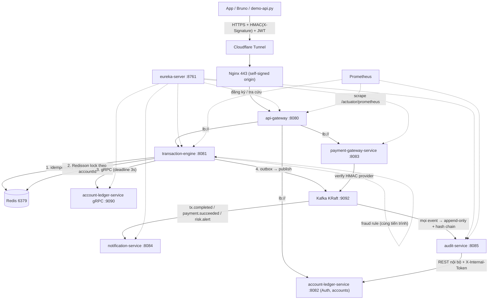

# PHẦN 2 — PHÂN TÍCH KIẾN TRÚC MICROSERVICES

> Đối chiếu giữa **yêu cầu trong `README.MD` §2** và **hệ thống đã triển khai thật** tại `/opt/fintech`
> (VPS `160.187.228.112`, domain `www.fintech-wallet4105.bid`).
>
> Cấu trúc tài liệu: **2.1** danh sách service (thừa/thiếu/mới) · **2.2** sơ đồ kiến trúc & cơ chế giao tiếp.
> Mỗi mục đều có: *README nói gì → hệ thống làm gì → vì sao khác*.

---

## 2.1. DANH SÁCH MICROSERVICES: ĐỐI CHIẾU README ↔ THỰC TẾ

### 2.1.1. Bảng đối chiếu tổng quan

| # | README §2.1 đề xuất | Thực tế triển khai | Trạng thái |
|---|---|---|---|
| 1 | API Gateway & Security Proxy | `api-gateway` (8080) | ✅ Giữ nguyên vai trò |
| 2 | Account & Core Ledger Service | `account-ledger-service` (8082 REST + 9090 gRPC) | ✅ Giữ, **mở rộng**: service này còn giữ cả Auth/JWT + `users`/`accounts` |
| 3 | Transaction Processing Engine | `transaction-engine` (8081) | ✅ Giữ, **mở rộng**: nhúng luôn Fraud rule engine + Outbox |
| 4 | Payment Gateway Integration Service | `payment-gateway-service` (8083) | ✅ Giữ, DB đổi sang PostgreSQL |
| 5 | **Fraud Detection & Risk Management Service** (Python/Go, tách riêng) | **Không tách service** — `FraudRuleEngine` nằm trong `transaction-engine` | ⚠️ Gộp |
| 6 | **Notification & Audit Service** (gộp 1 service) | **Tách 2 service**: `notification-service` (8084) + `audit-service` (8085) | ⚠️ Tách |
| — | *(README không có)* | **`eureka-server`** (8761) — service discovery | ➕ Thêm mới |
| — | *(README không có)* | `common`, `proto` — module dùng chung (không phải service) | ➕ Thêm mới |

**Kết luận nhanh:** README đề xuất **6 service**; hệ thống chạy **7 service**.
Không thiếu service nào về mặt *nghiệp vụ*; khác biệt nằm ở **cách chia** (gộp/tách) và **1 service hạ tầng được thêm** (Eureka).

### 2.1.2. Vì sao THÊM `eureka-server` (README không có)

README giả định Gateway biết địa chỉ service (hardcode `localhost:50051` trong ví dụ Nginx ở §4 Step 3).
Thực tế phải thêm Eureka vì **3 lý do kỹ thuật đo được**, không phải để cho đẹp kiến trúc:

1. **Blue/Green deploy đổi port liên tục.** Mỗi lần deploy, `deploy.sh` dời service sang `port + 1000` (xem Phần 4).
   Nếu Gateway/Ledger client hardcode `host:port`, sau deploy đầu tiên mọi lời gọi sẽ vào cổng chết — **đây là lỗi
   thật đã xảy ra** với `audit-service` (xem Phần 4, mục "sự cố 3"). Eureka cho phép địa chỉ được tra cứu động.
2. **gRPC cần địa chỉ động.** `transaction-engine` gọi `account-ledger-service:9090`; địa chỉ này do Eureka cấp.
3. **`lb://` client-side load balancing.** Gateway route bằng `lb://transaction-engine` thay vì IP:port.

> Đánh đổi: thêm 1 JVM (~384 MB) và 1 điểm phụ thuộc lúc khởi động (service phải chờ Eureka để đăng ký).
> Chấp nhận được vì nó **chặn được cả một lớp lỗi deploy**, trong khi RAM còn dư (xem bảng RAM bên dưới).

### 2.1.3. Vì sao **KHÔNG tách Fraud Detection** thành service riêng

| Yếu tố | Nếu tách service riêng (như README) | Thực tế: nhúng rule engine vào `transaction-engine` |
|---|---|---|
| Ngôn ngữ | Python/FastAPI hoặc Go → **toolchain thứ 2** (build, CI, image, log format, monitoring riêng) | Giữ **1 toolchain Java 21 + Maven**, `mvnw verify` phủ cả fraud |
| RAM | +1 JVM/service ≈ **300–500 MB** trên VPS 8 GB (ngân sách đã ~6,9 GB, xem 2.1.6) | 0 MB thêm |
| Độ trễ | Gọi đồng bộ/async thêm 1 network hop **trên đường tiền** | Gọi hàm trong cùng tiến trình, **0 hop** |
| Dữ liệu | Phải đồng bộ state (velocity counter) giữa 2 service, dễ lệch | Đếm velocity ngay trong transaction, cùng DB `tx_db` |
| Thời gian | 15 ngày, M4 (05–06/10) chỉ có 2 ngày cho Audit + Fraud | Fraud hoàn thành trong 2 ngày đó |

**Kết luận:** fraud ở đây là **rule engine** (VELOCITY, AMOUNT_LIMIT → `ALLOW/REVIEW/BLOCK`), không phải
mô hình ML cần scale riêng. Nhúng vào `transaction-engine` là lựa chọn **đúng theo ràng buộc tài nguyên + deadline**;
khi cần scale, có thể tách ra sau vì đã có sẵn Kafka topic `risk.alert` làm ranh giới.
Code: `backend/transaction-engine/.../service/FraudRuleEngine.java`, ghi bảng `fraud_alerts`, bắn `risk.alert`.

### 2.1.4. Vì sao **TÁCH Notification và Audit** (README gộp 1 service)

README §2.1 mục 6 gộp "Notification & Audit" và đề xuất DB `Elasticsearch / TimescaleDB`. Thực tế tách 2 service, cả hai dùng PostgreSQL:

1. **Vòng đời và tải khác hẳn nhau.** Notification là I/O ra SMTP (chậm, dễ fail, phải retry + dead-letter);
   Audit là ghi append-only + job đối chiếu định kỳ. Gộp lại thì SMTP chậm sẽ **chặn** chuỗi hash audit — đúng
   thứ không được phép chậm.
2. **`audit-service` phải độc lập khi báo động.** Khi lệch sổ, service bắn cảnh báo phải sống độc lập với
   service gửi mail. Nếu chung tiến trình, mail hỏng = mất luôn khả năng cảnh báo.
3. **Database-per-service.** Tách cho phép mỗi service sở hữu 1 DB riêng biệt (`notification_db`, `audit_db`),
   không service nào đọc chéo schema — đúng nguyên tắc trong `AGENTS.md` §7.
4. **RAM rẻ hơn tưởng tượng:** 2 JVM nhỏ (320m cấu hình, thực tế ~340–370 MB mỗi cái) vẫn rẻ hơn 1
   Elasticsearch/TimescaleDB (README đề xuất), vốn ngốn 1–2 GB.

**Bỏ Elasticsearch/TimescaleDB vì:** `AGENTS.md` chốt **PostgreSQL cho mọi service**; Elasticsearch ngốn
1–2 GB RAM và không cần cho khối lượng demo; audit log vẫn cần **bất biến + chuỗi hash**, thứ Postgres làm được
hoàn toàn (xem Phần 3, giai đoạn 1 và bảng `audit_logs`).

### 2.1.5. Vì sao `account-ledger-service` kiêm luôn Auth/JWT

README tách "Auth" như một phần của Gateway. Thực tế **Ledger service sở hữu `users` + cấp JWT**
(`AuthService.issueTokens`). Lý do:
- `users` gắn chặt với `accounts` (owner của ví) → để chung 1 service tránh FK chéo DB và tránh 1 network hop
  khi resolve "ví của user này" (thao tác mà `notification-service` cần cho endpoint 28/29).
- Gateway **chỉ verify** chữ ký JWT (stateless, dùng public key/secret chung) — đúng vai trò edge proxy, không
  giữ state người dùng.
- Role `ADMIN` cấp bằng allowlist `app.security.admin-phones` lúc login, không thêm bảng phân quyền — cắt theo
  danh sách "cắt khi trễ" (`docs/06` §3) vì deadline.

### 2.1.6. Ngân sách RAM — lý do gốc của mọi quyết định gộp/tách

VPS 8 GB / 4 vCPU (README §4 Step 1). Tổng `mem_limit` thực tế:

| Nhóm | RAM |
|---|---|
| OS + Docker daemon | ~800 MB |
| Kafka KRaft | 1280 MB |
| PostgreSQL | 512 MB |
| 7 service JVM (eureka 384 · gateway 448 · tx 512 · ledger 512 · payment 448 · notification 512 · audit 512) | ~3,3 GB |
| Nginx + Prometheus + Grafana + Loki + Alertmanager + exporter/cadvisor | ~1,2 GB |
| **Tổng** | **~6,9 GB / 8 GB** |

→ **Không còn chỗ cho service thứ 8** (fraud tách riêng) hay Elasticsearch. Đây là con số quyết định,
không phải sở thích kiến trúc.

### 2.1.7. Những thứ README có mà hệ thống **cố ý chưa làm**

| README | Thực tế | Lý do |
|---|---|---|
| Thanh toán **hóa đơn** (§1 mô tả) | Chỉ có nạp/rút/chuyển + payment intent | Không có sandbox đối tác thật; thời gian dồn cho luồng tiền + DevOps (trọng số điểm) |
| Payment DB **MongoDB** | PostgreSQL | `AGENTS.md`: PostgreSQL cho mọi service; 1 loại DB dễ vận hành/backup |
| Notification **push + SMS OTP** | Chỉ **email** (SMTP → Mailpit) | Danh sách cắt `docs/06` §3 ưu tiên bỏ push/SMS; OTP cho giao dịch lớn sinh in-memory trong Ledger |
| Fraud **GEO_ANOMALY / NEW_DEVICE** | VELOCITY + AMOUNT_LIMIT | Cắt theo `docs/06` §3 (cần dữ liệu thiết bị/IP không có trong demo) |
| **Spring Batch** cho đối chiếu | `@Scheduled` + JPA/REST | Danh sách cắt: Batch → `@Scheduled` khi hết thời gian (đã chọn phương án nhẹ) |

---

## 2.2. SƠ ĐỒ KIẾN TRÚC & CƠ CHẾ GIAO TIẾP

### 2.2.1. Sơ đồ thực tế (vẽ đúng cái đang chạy)



### 2.2.2. Bảng giao tiếp (đồng bộ / bất đồng bộ)

| Đường | Cơ chế | Vì sao chọn |
|---|---|---|
| Client → Gateway | HTTPS + **HMAC-SHA256** + JWT | Chống sửa dữ liệu trên đường truyền (README §2.1 #1) |
| Gateway → service nghiệp vụ | REST qua **`lb://`** (Eureka) | Địa chỉ động theo blue/green; có circuit breaker `resilience4j` |
| TxEngine → Ledger (đường tiền) | **gRPC** + deadline 3s | README §2.2: payload nhỏ, nhanh; **không retry** posting (chống trừ tiền 2 lần) |
| Ledger ← TxEngine | **1 chiều** | Ledger không gọi ngược TxEngine → không có vòng phụ thuộc |
| TxEngine / Payment → Kafka | Event qua **Transactional Outbox** | Không publish trong transaction DB (mất/không mất event) |
| Kafka → Notify / Audit | consumer idempotent | Redelivery là no-op (unique key theo event) |
| Audit → Ledger | REST nội bộ + `X-Internal-Token` | Đối chiếu **không đọc chéo DB** của service khác |
| Mọi service → Prometheus | `/actuator/prometheus` | Cảnh báo lệch sổ (README §4 Step 5) |

### 2.2.3. So với README §2.2 — cái gì giữ, cái gì khác

**Giữ đúng như README:**
- Client → Gateway có HMAC; Gateway → TxEngine; TxEngine → Redis (idempotency + lock) → gRPC → Ledger → Kafka.
- Kafka phân phối cho notification / audit / fraud.
- `X-Idempotency-Key: <UUID>` bắt buộc trên mọi API động tiền; Redis TTL 24h; trùng key + cùng payload →
  trả lại kết quả cũ, **không trừ tiền lần 2**.

**Khác README (kèm lý do):**

| Khác biệt | README | Thực tế | Lý do |
|---|---|---|---|
| Service discovery | Không nhắc (địa chỉ hardcode) | **Eureka** | Blue/green đổi port mỗi lần deploy; hardcode đã gây lỗi thật |
| Vẽ fraud | Service riêng nối Kafka | Nằm trong TxEngine, vẫn bắn `risk.alert` | RAM + deadline + 1 toolchain (§2.1.3) |
| Vẽ notification/audit | 1 service | 2 service riêng DB | Vòng đời khác nhau; audit phải độc lập khi cảnh báo (§2.1.4) |
| Publish Kafka | "Publish Tx Event" | Qua **Outbox** trong cùng transaction DB | Tránh mất event khi Kafka chết giữa chừng |
| gRPC ra ngoài | Nginx `grpc_pass` tới `grpc-ledger.yourdomain.com` | gRPC **chỉ nội bộ** trong mạng Docker; vhost `grpc.conf` không hoạt động | `deploy.sh` không publish port gRPC (xem Phần 4); test từ laptop bằng SSH tunnel tới IP container |
| Gateway route thêm | Chỉ tx + payment | Thêm ledger REST (auth/accounts), notification; **không** route `/api/v1/audit/**` | Audit/reconciliation là API admin, gọi trực tiếp service (least exposure) |
| Idempotency | Key ở Redis, TTL 24h | Giống README **+** UNIQUE key ở DB (`transactions.idempotency_key`) | Redis là lớp 1, unique constraint là chốt chặn thứ 2 ở tầng DB |

### 2.2.4. Luồng demo chính (dùng cho Phần 5)

```
(1) Chuyển tiền:  App → Nginx → Gateway (HMAC+JWT+rate limit)
                → TxEngine (idempotency Redis → Redisson lock → fraud rule)
                → gRPC → Ledger (ghi ≥2 dòng ledger_entries, Σ = 0, cập nhật snapshot cùng transaction)
                → Outbox → Kafka tx.completed
                    → notification-service (email biến động số dư)
                    → audit-service (append audit + chuỗi hash)

(2) Nạp tiền:     App → Gateway → Payment (tạo intent)
                Bank/đối tác → POST /webhooks/{provider} (HMAC của provider, chống trùng eventId)
                → Kafka payment.succeeded → TxEngine → gRPC → Ledger (Credit ví)
```

---

## 2.3. TÓM TẮT TRẢ LỜI NHANH KHI BỊ HỎI

1. **"Đề cho 6 service, sao em có 7?"** — README không nói tới service discovery; em thêm `eureka-server`
   vì blue/green deploy làm port đổi liên tục, hardcode `host:port` đã gây lỗi thật với audit-service.
2. **"Fraud Detection đâu?"** — Vẫn có, là `FraudRuleEngine` trong `transaction-engine` (VELOCITY + AMOUNT_LIMIT,
   ghi `fraud_alerts`, bắn `risk.alert`). Không tách service vì VPS 8 GB chỉ còn ~1 GB dư và deadline 15 ngày.
3. **"Sao tách Notification với Audit mà đề gộp?"** — SMTP chậm/retry không được phép chặn chuỗi hash audit;
   khi lệch sổ, service cảnh báo phải sống độc lập với service gửi mail.
4. **"Sao không dùng MongoDB / Elasticsearch như đề?"** — Ràng buộc dự án chốt PostgreSQL cho mọi service,
   và ES ngốn 1–2 GB RAM không cần cho khối lượng demo.
5. **"Vì sao khác README?"** — Ba ràng buộc cụ thể: **thời gian 15 ngày**, **VPS 4 vCPU/8 GB**, và
   **1 toolchain Java** (không thêm ngôn ngữ backend thứ 2).
