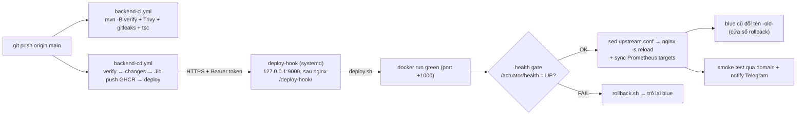

# PHẦN 4 — HƯỚNG DẪN TRIỂN KHAI THỰC TẾ LÊN VPS (theo `README.MD` §4)

> `README.MD` §4 mô tả 5 bước triển khai lý thuyết. Tài liệu này ghi **đúng cách hệ thống đang chạy**,
> **so sánh với README**, và **lý do phải làm khác** (bám theo `docs/09-cicd-pipeline.md` §13 — nhật ký
> triển khai thật, và `docs/10-defense-demo-runbook.md`).
>
> Môi trường: VPS `160.187.228.112` · domain `https://www.fintech-wallet4105.bid` · thư mục repo `/opt/fintech`.

---

## 4.1. Luồng deploy đang chạy (một hình để nhớ)



**Khác biệt cốt lõi so với README:** README §4 Step 4 mô tả *"build → Jib push GHCR → **SSH deploy**"*.
Thực tế **không SSH được** (xem 4.2 Step 1), nên đường deploy đi qua **Cloudflare Tunnel → deploy hook**.

---

## 4.2. Đối chiếu từng bước README §4 ↔ thực tế

### Step 1 — Hạ tầng VPS & bảo mật

| README | Thực tế | Lý do khác |
|---|---|---|
| Cloud VPS Ubuntu 22.04, 4 vCPU / 8 GB / SSD 50 GB | Đúng: VPS Ubuntu, 4 vCPU / 8 GB (đã kiểm `free -m`, `nproc`) | Không đổi |
| Khoá SSH bằng key, **tắt password login** | Đúng: user `deploy` chỉ nhận key, `PasswordAuthentication no`, không login root | Không đổi |
| UFW: chỉ mở **22/80/443** | Đúng về cấu hình, **nhưng thực tế inbound bị chặn theo địa lý**: 22/80/443 chỉ phản hồi từ node **Việt Nam**; từ US/EU/SG **timeout toàn bộ** | Nhà cung cấp VPS chặn theo nguồn — đo bằng check-host/Let's Encrypt/hạ tầng độc lập. Hệ quả: Let's Encrypt không validate được, GitHub runner không SSH được |
| (không nói) | Chiều **ra** cũng bị chặn một phần: `registry-1.docker.io`, `public.ecr.aws`, `login.tailscale.com` timeout; `github.com`, `gcr.io`, `api.cloudflare.com`, `api.telegram.org` thì tới được; anycast Microsoft (`pipelines.actions.githubusercontent.com`) bị chặn | ⇒ Docker Hub không pull được → phải dùng **registry mirror**; **self-hosted runner bất khả thi** (không poll được job) |

### Step 2 — Build pipeline cho gRPC/Protobuf

| README | Thực tế | Lý do khác |
|---|---|---|
| Ví dụ **Go**: `Dockerfile` multi-stage, `protoc`, image `alpine` | **Java 21 + Maven multi-module**: module `proto` dùng `protobuf-maven-plugin` sinh Java stub; image build bằng **Jib** (không Dockerfile), **không cần Docker daemon** | Ràng buộc dự án chốt **1 toolchain Java** (tránh nuôi 2 hệ build); Jib build image tất định, không cần `docker build`, phù hợp runner GitHub |
| `EXPOSE 50051` | Ledger gRPC ở **9090** (HTTP REST 8082) | Theo `docs/02`; 9090 vẫn là cổng mặc định của gRPC ecosystem |

Lệnh thật:
```bash
# local: build + test toàn bộ
cd backend && ./mvnw -B verify
# CI/CD: build image và push GHCR (tag = git SHA)
./mvnw -B -pl account-ledger-service -am -DskipTests package jib:build \
  -Djib.to.image=ghcr.io/<owner>/fintech-wallet-account-ledger-service:<sha>
```

### Step 3 — Nginx proxy cho REST **và** gRPC (HTTP/2)

| README | Thực tế | Lý do khác |
|---|---|---|
| `server_name grpc-ledger.yourdomain.com`, cert Let's Encrypt, `grpc_pass grpc://localhost:50051` | `infra/nginx/conf.d/api.conf` (443, REST + `/deploy-hook/`) và `grpc.conf` (`grpc_pass grpc://ledger_grpc`) **tồn tại nhưng vhost gRPC không hoạt động** | `deploy.sh` chỉ publish **1 cổng HTTP** cho mỗi service, nên `upstream ledger_grpc { server 127.0.0.1:9090; }` trỏ vào cổng **không ai listen** → đây là **nợ kỹ thuật đã ghi nhận** (`docs/09` §13.8) |
| TLS do certbot cấp | **Cloudflare Tunnel** giữ TLS ở edge; origin dùng **self-signed** đặt đúng đường dẫn `/etc/letsencrypt/live/<PUBLIC_DOMAIN>/` để không phải sửa compose; **bỏ certbot + `certbot.timer`** | Let's Encrypt (server US/EU) **không validate được** VPS này (Step 1). Đổi sang Cloudflare Tunnel vì chỉ cần **chiều ra** (QUIC 7844) |
| gRPC gọi được từ Internet | **Không demo gRPC từ Internet.** gRPC giữa TxEngine → Ledger đi **trực tiếp trong mạng Docker** (`account-ledger-service:9090`). Khi cần test gRPC từ laptop, dùng **SSH tunnel tới IP container** (không phải `127.0.0.1:9090`) | Tránh mở cổng gRPC ra ngoài; vẫn test được 8 RPC — xem Phần 5, tiêu chí 3 |

### Step 4 — CI/CD nghiêm ngặt

| README | Thực tế | Lý do khác |
|---|---|---|
| Unit + Integration test trước khi deploy | `backend-ci.yml`: `./mvnw -B verify` (surefire + failsafe/Testcontainers) + **Trivy** scan + **gitleaks** + `tsc --noEmit` cho app | Thêm gitleaks vì từng có secret lọt vào workspace |
| Blue/Green hoặc Canary | **Blue/Green theo từng service**: green chạy ở `port + 1000`, health gate `/actuator/health`, rồi `sed` `upstream.conf` + `nginx -s reload`; container cũ giữ lại làm cửa sổ rollback | Canary cần điều phối traffic phức tạp; blue/green 1 container phù hợp VPS 8 GB |
| "SSH deploy" (README M6) | **Deploy qua HTTPS hook** (`deploy-hook.py`, systemd, `127.0.0.1:9000`, sau nginx `/deploy-hook/`), xác thực Bearer token, **whitelist tên service** + sha 40 hex | GitHub runner **không SSH được** vào VPS (Step 1). Hook công khai ra Internet nên phải whitelist để không biến thành "chạy lệnh tuỳ ý" |
| (không nói) | `deploy.sh` còn **đồng bộ target Prometheus** sau mỗi swap (`sync-prometheus-targets.sh` + SIGHUP) | Prometheus scrape theo cổng base đã sai sau blue/green — sự cố 3 bên dưới |

### Step 5 — Monitoring & Alerting

| README | Thực tế | Lý do khác |
|---|---|---|
| Prometheus + Grafana, cảnh báo Telegram/Email khi **tỷ lệ fail > 2%** và **Σ Debit ≠ Σ Credit** | Đủ: Prometheus + Grafana + **Alertmanager → Telegram**; thêm **Loki + Promtail** gom log JSON tra theo `requestId`; Mailpit để xem email | Loki nằm trong danh sách cắt ở `docs/06` nhưng vẫn kịp làm → giữ để tra log xuyên service |
| Metric lệch sổ | `ledger_imbalance` (tên export thật, Micrometer bỏ hậu tố `_total`) và `reconciliation_last_success_timestamp_seconds` | Cảnh báo dựa trên **số dư đối chiếu** chứ không chỉ log |
| (không nói) | Prometheus/Loki/Grafana **không publish ra host** (chỉ trong `fintech-net`), không lộ dashboard ra Internet | Nguyên tắc least exposure; muốn xem thì SSH tunnel |

---

## 4.3. Các bước deploy **hiện tại** (thao tác chi tiết)

### A. Deploy thường (đường chuẩn, dùng 99% trường hợp)

```bash
# 1. Trên máy dev: commit và push lên main
git add <files> && git commit -m "..." && git push origin main

# 2. GitHub Actions: backend-ci chạy verify + scan; backend-cd chạy verify → build image (chỉ service thay đổi) → deploy
gh run list --limit 3            # xem run ID
gh run watch <run-id> --exit-status
```

**Cơ chế bên trong** (đọc khi bị hỏi):
1. `changes` job diff **cả push** (`github.event.before..github.sha`) để biết service nào cần build
   — nếu `proto/` hoặc `common/` đổi thì build lại **cả 7**.
2. `build-push` matrix: Jib build đúng service đó, tag = git SHA, push lên GHCR.
3. `deploy` job gọi hook: `POST /deploy-hook/deploy {service, sha}` → poll `/status/<id>` tới `done`.
4. Hook chạy `infra/scripts/deploy.sh <service> <sha>` trên VPS.

### B. Deploy một service cụ thể / deploy lại cùng image (không cần code mới)

```bash
gh workflow run backend-cd.yml --ref main -f services=audit-service
```
Dùng khi: đã đổi `.env` trên VPS (mem limit, ADMIN_PHONES…) và chỉ cần **recreate container** để nạp lại env —
vì env chỉ đọc lúc `docker run`, `docker restart` **không** nạp lại `--env-file`.

### C. Deploy tay trên VPS (khi cần, ví dụ CI hỏng)

```bash
ssh deploy@160.187.228.112
cd /opt/fintech
infra/scripts/deploy.sh audit-service $(git rev-parse HEAD)     # deploy theo SHA đang có
infra/scripts/rollback.sh audit-service                          # quay lại bản blue đang giữ
```

### D. Kiểm tra sau mỗi deploy

```bash
docker ps --format 'table {{.Names}}\t{{.Ports}}\t{{.Status}}'
grep -E 'upstream' infra/nginx/conf.d/upstream.conf      # cổng thật đang chạy của từng service
curl -fsS https://www.fintech-wallet4105.bid/actuator/health | grep '"status":"UP"'
for s in notification-service audit-service; do \
  docker inspect -f '{{.Name}} restarts={{.RestartCount}} mem={{.HostConfig.Memory}}' $s; done
```

> **Health không đủ.** `smoke test` hiện tại chỉ kiểm health gateway + endpoint login trả 400/405.
> Phải kiểm **đường tiền** (transfer nhỏ) — đã có lần health xanh nhưng eureka sai cổng khiến mọi route `lb://` trả 503.

---

## 4.4. Những sự cố THẬT đã gặp và cách xử lý (phần "vì sao lại làm vậy")

Đây là phần nên kể khi bảo vệ, vì nó chứng minh quy trình deploy đã được **kiểm chứng bằng lỗi thật**.

| # | Sự cố | Triệu chứng | Nguyên nhân | Cách chữa |
|---|---|---|---|---|
| 1 | `jq -R -s` trên output của `echo` | Matrix `service` chứa `\n` → dòng `./mvnw -pl` bị cắt, Maven báo "No goals have been specified" | `echo` giữ newline | Dùng `printf '%s'` |
| 2 | `jib:build` gọi trực tiếp | "Obtaining project build output files failed" | Không chạy lifecycle ⇒ checkout sạch không có `target/classes` | Thêm `-DskipTests package` **trước** `jib:build` |
| 3 | `deploy.sh` giả định luôn có blue cũ | Lần deploy đầu: `docker stop` lỗi, `set -e` thoát **sau khi** đã swap nginx | Container chưa tồn tại | Bọc `docker container inspect` trước khi stop/rename |
| 4 | `deploy.sh` set `SERVER_PORT` cho **mọi** service | Eureka bị đẩy sang cổng khác, mọi client trỏ `EUREKA_HOST:8761` ⇒ không ai đăng ký được ⇒ route `lb://` trả **503** | Eureka là ngoại lệ: client trỏ cứng theo tên service, không qua discovery | Chỉ đổi cổng **publish** của eureka, giữ cổng lắng nghe 8761 |
| 5 | Hardcode `host:port` khi gọi service khác | `audit-service` luôn ghi reconciliation `FAILED`: `Connect to http://account-ledger-service:8082 failed` | Blue/green đã dời ledger sang `+1000`, URL hardcode còn ở cổng base | Chuyển sang **Eureka service id** + `@LoadBalanced RestClient` (giống notification) |
| 6 | Prometheus scrape cổng base | `up=0` cho **6/7** service ⇒ dashboard/alert không có dữ liệu | `prometheus.yml` trỏ `notification-service:8084`… trong khi blue/green dời cổng | `sync-prometheus-targets.sh`: viết lại **toàn bộ** target từ `upstream.conf` rồi `docker kill -s HUP prometheus`; gọi ở cuối `deploy.sh` |
| 7 | `notification-service` bị OOM-kill | `docker events`: `oom` → `die exitCode=137`, restart 56 lần, 4 endpoint chết theo | `MaxRAMPercentage=70` + `mem_limit=320m` ⇒ chỉ còn ~96 MB cho non-heap (metaspace/code cache/thread) | Nâng `NOTIFICATION_SERVICE_MEM` và `AUDIT_SERVICE_MEM` lên `512m` |
| 8 | Audit chain luôn `valid=false` | `verify-chain` trả `valid=false, checkedEntries=0` | `audit_logs.payload` để `jsonb` ⇒ Postgres chuẩn hoá lại chuỗi ⇒ hash tính lúc ghi ≠ hash tính lúc verify | Đổi cột sang `text`; DB đang tồn tại phải chạy tay `TRUNCATE audit_logs; ALTER TABLE … TYPE text;` |
| 9 | CD **im lặng không deploy** | Push nhiều commit: run **xanh** nhưng không deploy gì | `changes` chỉ diff `HEAD~1..HEAD` ⇒ chỉ thấy module của commit cuối | Diff **cả push** (`before..sha`, `fetch-depth: 0`) |
| 10 | Sửa `deploy.sh` không có tác dụng ngay | Vừa thêm bước mới nhưng lần deploy đó không chạy | Tiến trình đang chạy là bản đọc từ đĩa lúc gọi; `git checkout` giữa thân script **không** đổi code đang chạy | Ghi nhận: thay đổi `deploy.sh` có hiệu lực từ lần deploy **kế tiếp** |

---

## 4.5. Các ràng buộc của VPS/domain ảnh hưởng tới thiết kế deploy

| Ràng buộc đo được | Hệ quả kiến trúc |
|---|---|
| 22/80/443 chỉ phản hồi từ node VN | Không dùng certbot; CD không SSH; dùng Cloudflare Tunnel + deploy hook |
| Docker Hub (`registry-1.docker.io`) không tới được | Cấu hình registry mirror `mirror.gcr.io` |
| DNS `ghcr.io` trả IP không route được từ VPS | **Pin 4 IP GHCR thật vào `/etc/hosts`** (`140.82.112.33` …) — bước bắt buộc khi dựng lại VPS |
| Anycast Microsoft bị chặn | Self-hosted GitHub runner bất khả thi → vẫn dùng `ubuntu-latest` và **gọi hook** thay vì SSH |
| 8 GB RAM, 4 vCPU | `mem_limit` từng container trong `.env`; không thêm service/ES |
| Deadline 15 ngày (28/09 → 12/10) | Chọn mỗi thứ **đơn giản nhất còn chạy được**: Jib thay Dockerfile, `@Scheduled` thay Spring Batch, blue/green 1 container thay canary |

---

## 4.6. Checklist dựng lại VPS từ đầu (rút gọn — chi tiết: `docs/09` §13.7)

```bash
# 1. gói cơ bản + git + Docker + UFW 22/80/443
# 2. clone /opt/fintech bằng deploy key read-only
# 3. cp infra/docker/.env.example infra/docker/.env  → điền secret (chmod 600)
#    - JWT_SECRET PHẢI là base64 CHUẨN (Decoders.BASE64) — '-'/'_' làm app chết lúc khởi động
#    - DEPLOY_HOOK_TOKEN phải trùng GitHub secret cùng tên
# 4. docker compose -f infra/docker/docker-compose.yml up -d            # hạ tầng
# 5. pin ghcr.io vào /etc/hosts + registry mirror mirror.gcr.io
# 6. docker login ghcr.io
# 7. self-signed cert tại /etc/letsencrypt/live/<PUBLIC_DOMAIN>/
# 8. docker compose ... up -d nginx                                     # cần đủ 3 file compose
# 9. sudo cp infra/systemd/fintech-deploy-hook.service /etc/systemd/system/ && enable --now
# 10. cloudflared service install <token> + khai public hostname trên Zero Trust
# 11. deploy 7 service (hoặc bấm workflow_dispatch để CI/CD làm)
```

> Trên VPS, **7 service backend do `deploy.sh` quản lý** (không phải `docker compose`): compose chỉ chạy
> hạ tầng (postgres/redis/kafka/monitoring/mailpit) và nginx. Vì vậy **đừng `docker compose up -d` cho service app**
> trên VPS — sẽ tranh cổng với container blue/green.

---

## 4.7. Xem & chứng minh Monitoring khi bảo vệ (README §4 Step 5)

Cả 5 container monitoring đều **không publish ra host** (chỉ nginx mới publish), nên phải đi qua **tunnel tới IP container** —
`bruno-tunnel.sh` đã làm sẵn việc đó.

```bash
# [LAPTOP] mở tunnel (kèm luôn 5 port REST + gRPC như cũ)
infra/scripts/bruno-tunnel.sh
DRY_RUN=1 infra/scripts/bruno-tunnel.sh     # chỉ in ra các forward, không mở
```

| Cái gì | URL từ laptop | Tài khoản | Chiếu để chứng minh |
|---|---|---|---|
| **Grafana** | http://127.0.0.1:3000 | `admin` / `change-me-grafana` (giá trị trong `.env` VPS) | Dashboard **FinTech Wallet - Overview**: ledger imbalance = 0, throughput, p95 latency, error rate, RAM/disk |
| **Prometheus** | http://127.0.0.1:9091 | (không auth) | Targets `backend` = UP 7/7; tab **Alerts** có 5 rule; gõ `ledger_imbalance` |
| **Loki** | http://127.0.0.1:3100 | (không auth) | Truy vấn log theo service (xem dưới) |
| **Alertmanager** | http://127.0.0.1:9093 | (không auth) | Trạng thái alert + đường gửi Telegram |

> ⚠️ Prometheus dùng **local port 9091** (không phải 9090) vì 9090 đã dành cho gRPC của ledger.
> ⚠️ **Phải chạy lại tunnel sau khi recreate một container monitoring** (ví dụ đổi config Prometheus rồi
> `docker compose up -d prometheus`): container được tạo lại ⇒ **IP container đổi** (đã gặp: prometheus
> `172.18.0.15` → `172.18.0.3`) ⇒ forward cũ chết. Script resolve IP lúc chạy nên chỉ cần `Ctrl+C` rồi chạy lại.
> ⚠️ **Sau khi deploy/restart `audit-service`, alert `ReconciliationStale` sẽ `pending`** vì gauge reset về 0
> khi khởi động lại. Chạy một lần `37 - Reconciliation - Run` là alert tự về `inactive` (đúng luồng demo ở Bước F).

### Truy vấn mẫu để chiếu (Grafana → Explore → chọn datasource Loki)

```logql
{container="transaction-engine"}                       # log 1 service (đúng cho DoD docs/06)
{container=~"transaction-engine|audit-service"} | json  # gộp 2 service, tách field JSON
{container="account-ledger-service"} |= "verify-chain"   # tìm theo từ khoá
```
DoD `docs/06` ngày 10: **tra 1 `requestId` ra log xuyên 2 service** →
```logql
{container=~"api-gateway|transaction-engine"} | json | requestId="<dán requestId từ response>"
```

### 5 alert rule đang chạy (kiểm bằng Prometheus → Alerts)

| Alert | Biểu thức | Ý nghĩa |
|---|---|---|
| `LedgerImbalance` | `ledger_imbalance != 0` | **Quan trọng nhất**: nợ ≠ có ⇒ tiền bị sinh/mất |
| `TxErrorRateHigh` | rate lỗi 5xx của tx-engine > 2% (5m) | README §4 Step 5 |
| `ServiceDown` | `up{job="backend"} == 0` (1m) | Service chết |
| `VpsResourcePressure` | RAM < 15% trống hoặc disk > 85% | VPS mỏng RAM |
| `ReconciliationStale` | quá 25h không đối chiếu thành công | "Hàng phòng thủ cuối" im lặng |

### Demo alert (tuỳ chọn — chỉ khi thời gian cho phép)
```bash
# [SSH] làm 1 service "chết" để ServiceDown bắn (alert rule `for: 1m`)
docker stop transaction-engine
# chờ ~60–90s, mở Alertmanager 9093 xem alert chuyển Firing (+ tin Telegram nếu bot đã cấu hình)
docker start transaction-engine
```
> Telegram **đã có** `TELEGRAM_BOT_TOKEN`/`TELEGRAM_CHAT_ID` trong `.env` và Alertmanager đã substitute đúng.
> Vẫn nên **thử trước** 1 lần vì đây là bước dễ trượt nhất nếu bot bị chặn.

### Bốn lỗi monitoring đã phát hiện và sửa (nên kể: "vì sao lại làm vậy")

| Lỗi | Triệu chứng thật | Nguyên nhân | Cách chữa |
|---|---|---|---|
| Tên metric sai | Alert `LedgerImbalance` **không bao giờ bắn**; panel "Ledger imbalance" của dashboard **No data** | Code đặt tên gauge `ledger_imbalance_total`, nhưng Micrometer **bỏ hậu tố `_total`** khi export (hậu tố đó thuộc về counter) ⇒ tên thật là `ledger_imbalance`, còn alert/dashboard lại query `ledger_imbalance_total` | Đổi cả 4 nơi về `ledger_imbalance`: code gauge, `alert-rules.yml`, `overview.json`, docs/skills |
| Label log dính hậu tố slot | Panel log của dashboard **rỗng**; `{container="transaction-engine"}` **không ra gì** | Blue/green chạy container mới tên `<service>-green` rồi mới rename, và promtail giữ tên nó thấy **lần đầu** ⇒ label là `transaction-engine-green`, không khớp query | Thêm `relabel_configs` bỏ hậu tố `-green` / `-old-<ts>` trong `promtail-config.yml`; nới regex panel log để đọc được cả dữ liệu cũ |
| Prometheus scrape cổng **cũ** sau deploy | `up=0` cho 1 service: nó scrape `audit-service:13085` trong khi service đã ở `14085` | Config bind-mount dạng **2 file rời**; `git checkout` trong `deploy.sh` **thay file (inode mới)** còn container giữ **inode cũ** ⇒ ghi tại chỗ + SIGHUP vẫn đọc bản cũ (đo được: host inode `560633` vs container `532485`) | Đổi sang **mount thư mục** `../monitoring/prometheus:/etc/prometheus-cfg:ro`, `--config.file` + `rule_files` trỏ vào đó (chỉ Prometheus cần, vì các service monitoring khác đọc config 1 lần lúc start) |
| Alert `ServiceDown` **báo động giả sau mỗi deploy** | Cứ deploy xong là có alert critical `ServiceDown` cho `audit-service:13085` (port cũ) | `instance` là `service:port`; blue/green đổi port ⇒ series cũ `up=0` tồn tại vài phút trong khi series mới đã `up=1`. **Bẫy kỹ thuật:** `metric_relabel_configs` **không** áp cho metric `up` (Prometheus sinh `up` sau bước relabel) nên không thể gắn label `service` từ đó | Strip port **trong rule** bằng `label_replace`: `max by (service) (label_replace(up{job="backend"}, "service", "$1", "instance", "([^:]+):.*")) == 0` |

---

## 4.8. Câu trả lời nhanh khi bị hỏi về deploy

1. **"Sao không SSH deploy như tài liệu?"** — VPS chặn inbound 22 từ ngoài VN (và GitHub runner ở US), nên
   phải đi đường **Cloudflare Tunnel → deploy hook** có Bearer token + whitelist service/sha.
2. **"Certbot đâu?"** — Let's Encrypt không validate được VPS này; TLS do **Cloudflare** giữ, origin self-signed.
3. **"Blue/green thật không?"** — Có: green chạy `port+1000`, health gate `/actuator/health`, swap
   `upstream.conf` + reload nginx, container cũ giữ làm cửa sổ rollback (`rollback.sh` 1 lệnh).
4. **"Deploy 0 downtime không?"** — Nginx chỉ swap sau khi green healthy; container cũ **không** bị xoá ngay
   mà đổi tên `<service>-old-<ts>`, xoá ở lần deploy **kế tiếp**.
5. **"gRPC có expose ra Internet không?"** — Không. gRPC nội bộ trong mạng Docker; `grpc.conf` là vhost chết
   (nợ kỹ thuật đã ghi `docs/09` §13.8); test từ ngoài bằng SSH tunnel tới IP container.
